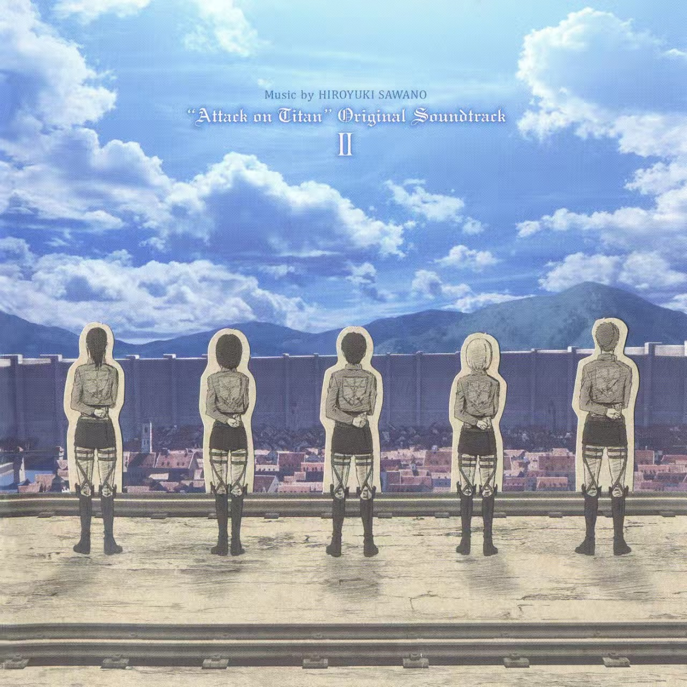
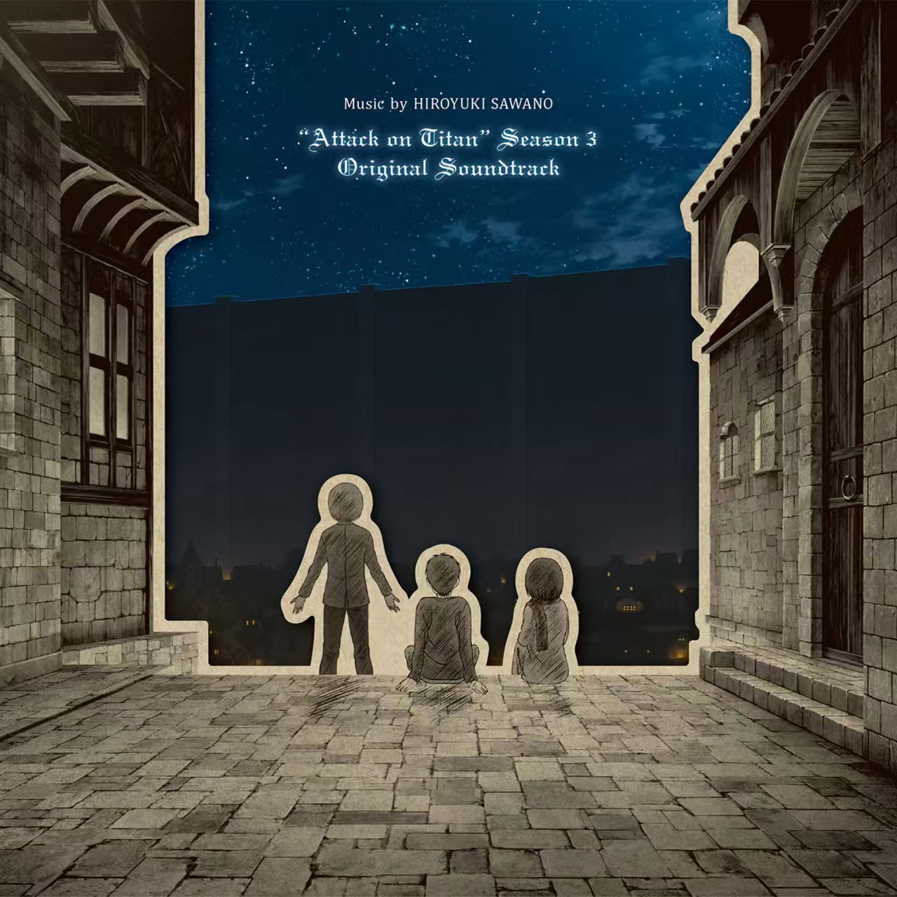
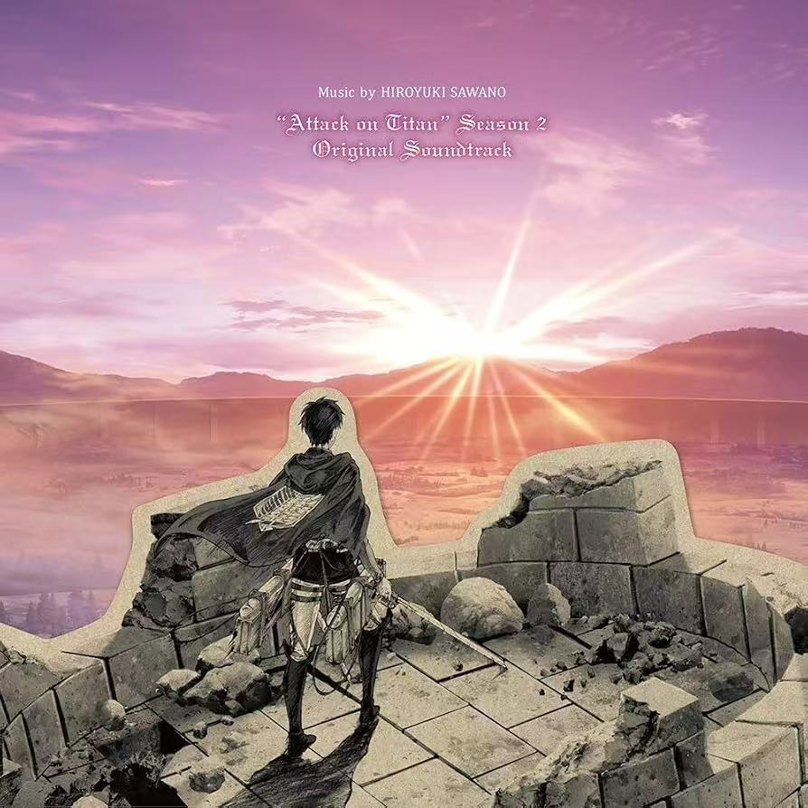
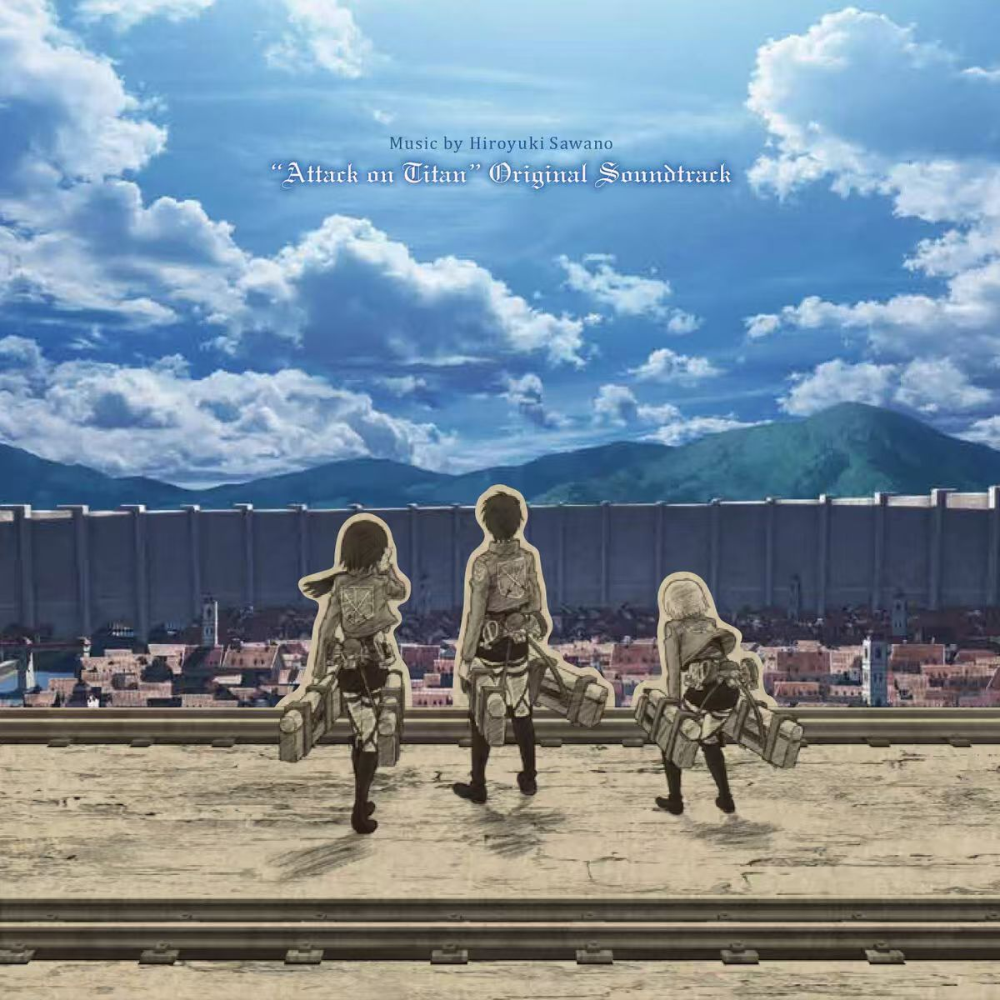

# inkcut-cover-skill

剪纸墨线·史诗原声带封面风（Paper-Cutout Ink OST Cover）AI 绘图技能：直接出图，不用教程或占位图代替。

黑白漫画墨线前景 + 米白剪纸边 + 彩色绘景背景 + 克制哥特标题，适合专辑封面、歌词卡、X/小红书配图及公众号头图。

## 风格 DNA

- **双材质**：人物与近景为黑白/暖纸灰漫画墨线（细排线、交叉排线、网点、纸纹）；天空、远城、山海等实际远景保持彩色写实质感
- **实体纸边**：前景外轮廓带连续米白剪纸边（约短边 0.8%–1.5%），极薄接触投影，无荧光光晕
- **人物尺度**：新构图优先静态背影/侧背影，单人高度约占画面 15%–35%
- **空间留白**：用真实天空、海面、雾留白，安静史诗感
- **克制排版**：极小作者行 + 两行小哥特英文主/副标题（Blackletter/Fraktur），宽度约 50%–70%，不做巨型营销标题

## 默认输出：三张一组

| 顺序 | 有原图时 | 纯文字/风格时 |
|---|---|---|
| ① | 原图保留版：锁定人物与大物体的位置、尺度、姿态、朝向，只转材质 | 基准构图版 |
| ② | 构图优化版：适度调整尺度、间距、景深 | 优化构图与留白 |
| ③ | 氛围变化版：同主题同人数，变化光线、色温、薄雾 | 变化光色情绪 |

## 运行条件

本技能不是独立应用，出图能力由宿主 AI 助手提供：

- **图像生成与编辑**：需宿主内置生图工具（生成、材质转绘、定向修字都靠它）；技能本身不调用任何模型或 API
- **Python 脚本（可选）**：`build_prompts.py` 只负责把规则展开成提示词 JSON，`typeset_cover.py` 只负责给无字底图后排版（依赖 `requirements.txt`）
- 无 Python 环境时技能仍可工作，脚本是稳定化手段而非硬依赖

## 安装

**方式一：下载 Release 压缩包**

从 [Releases](https://github.com/Zyl857857/inkcut-cover-skill/releases) 下载 `inkcut-cover-skill.zip`，解压到你的 agent 技能目录（如 `~/.agents/skills/`）。

**方式二：克隆**

```bash
git clone https://github.com/Zyl857857/inkcut-cover-skill.git ~/.agents/skills/inkcut-cover-skill
```

后排版（真实 Fraktur 字体渲染）需要：

```bash
pip install -r requirements.txt   # Pillow>=10, fonttools>=4.40
```

## 使用

安装到支持 SKILL.md 的 AI 编程助手中，直接说话即可触发：

- "剪纸墨线风出一张黄昏废墟的封面"
- "把这张照片转成 OST 封面"（附图）
- "用 inkcut-cover-skill 出三张海边的封面"

也可单独运行提示词构建脚本（只输出 JSON，不调用模型）：

```bash
python scripts/build_prompts.py --preset B
python scripts/build_prompts.py --source-image 原图.jpg --people-count 3 \
  --source-layout '人工看图得到的位置锚点'
```

常用参数：`--no-text` 无字方案（不添加文字、不为排版改变构图）；未指定作者时不渲染署名行；`--subtitle ''` 关副标题；`--credit-text 'LIN'` 指定作者行；`--count` 仅在明确改数量时使用。

## 预设（references/presets.json）

| 预设 | 标签 | 画面 |
|---|---|---|
| A | 夜·童年 | 靛蓝星夜，石板小巷，三个孩子背坐望远方巨墙 |
| B | 黄昏·孤独 | 紫粉日落，废墟高台，一名披斗篷旅人背影（无图无指定时的默认） |
| C | 晴天·羁绊 | 蓝天积云，城墙顶端，五名同伴并肩背影 |
| D | 黎明·终章 | 淡紫黎明，海岸悬崖，一人静坐望海平线 |

## 目录结构

```
inkcut-cover-skill/
├── SKILL.md                        # 技能主逻辑：输入分类、三张分工、风格规则、自检
├── agents/openai.yaml              # agent 配置
├── assets/
│   ├── icon.svg
│   └── references/                 # 5 张风格参考图
├── references/
│   ├── presets.json                # A/B/C/D 氛围预设
│   ├── prompt-template.txt         # 文字生图提示词模板
│   ├── preserve-source-template.txt# 原图保留版模板
│   ├── reference-study.md          # 案例视觉规则拆解
│   └── typography-and-lyrics.md    # 哥特字体、中文排版与歌词卡规则
├── scripts/
│   ├── build_prompts.py            # 展开提示词为 JSON
│   └── typeset_cover.py            # 无字底图后排版
└── requirements.txt                # Pillow, fonttools
```

## 效果参考

> **待补：真实成图对比组**（原图 → ①原图保留版 → ②构图优化版 → ③氛围变化版）。补图后放此处，比文字描述更直观。

当前可参考技能内置的风格案例：

| 01 晴天·五人 | 02 星夜·三人 | 03 紫粉落日·单人 |
|:---:|:---:|:---:|
|  |  |  |

| 04 橙金厚云 | 05 晴天·三人 |
|:---:|:---:|
|  |  |

## License

仅供个人创作使用，参考图与生成规则请勿商用或混入他人作品元素。
